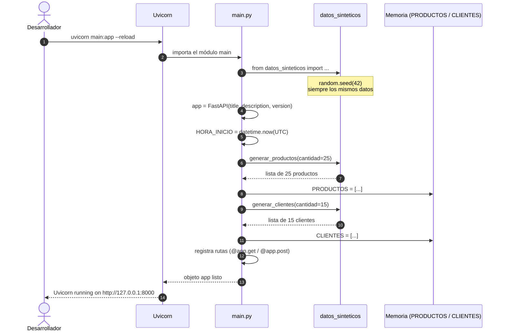
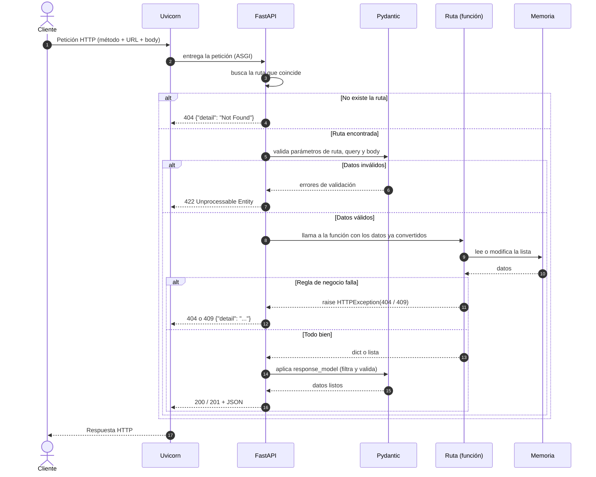
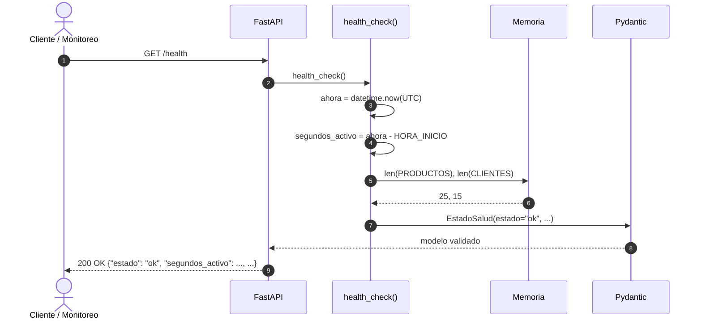
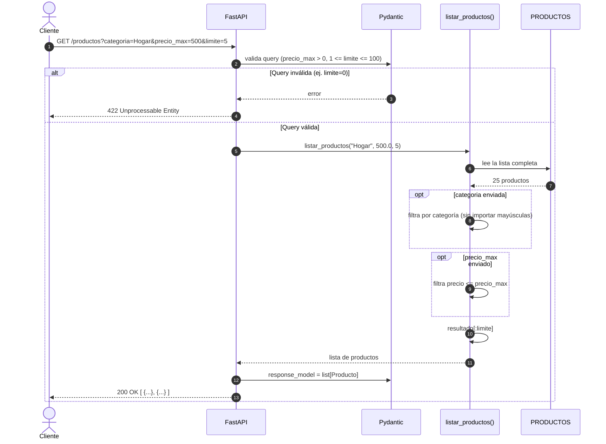
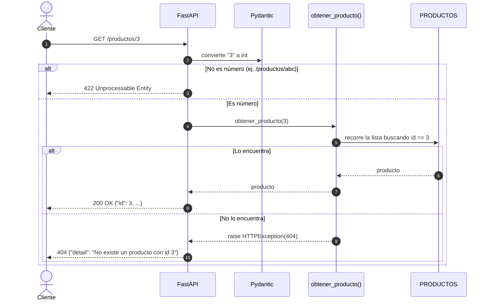
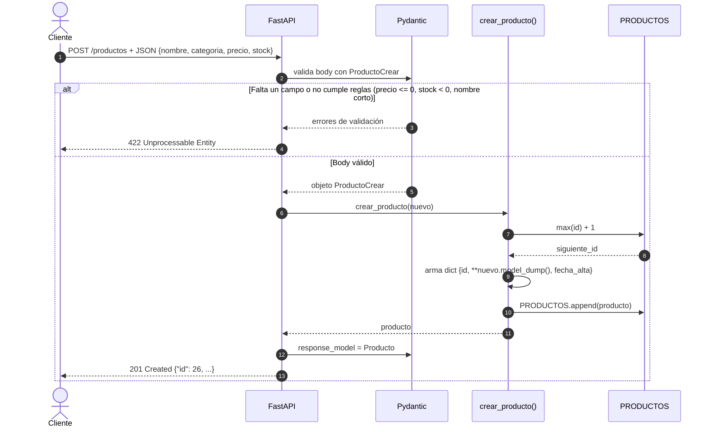
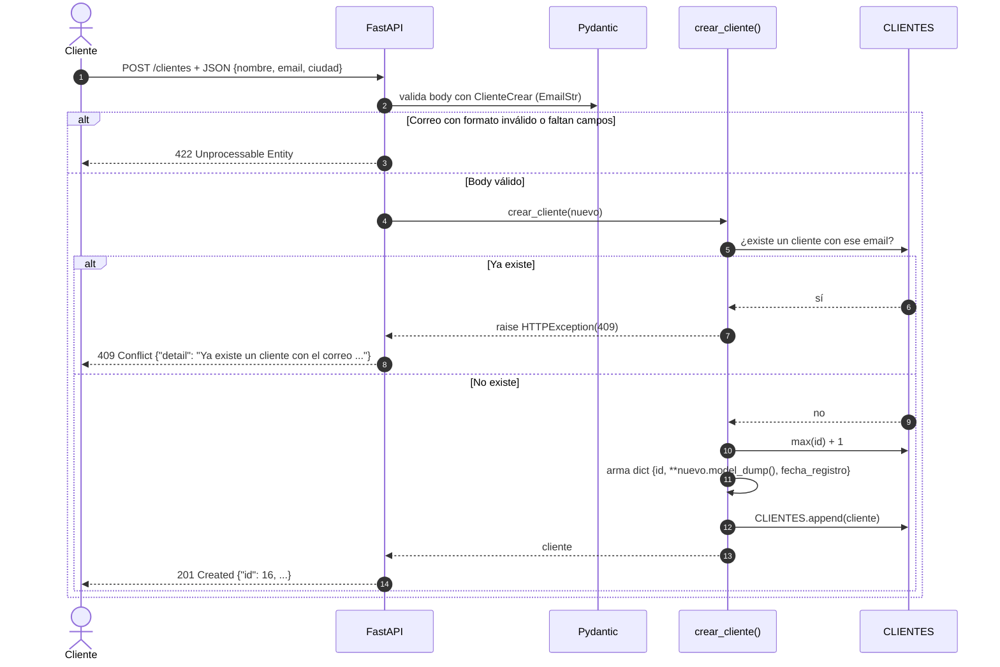

# Diagramas de secuencia de la Demo Tienda API

Este documento muestra, paso a paso, **qué pasa por dentro** cuando la API arranca y cuando recibe una petición. Los diagramas están escritos en [Mermaid](https://mermaid.js.org/), así que GitHub los dibuja automáticamente.

## Participantes

| Participante | Qué es en el proyecto |
|---|---|
| **Cliente** | Quien hace la petición: el navegador, `/docs`, `curl`, Postman o un programa en Python. |
| **Uvicorn** | El servidor que escucha en `http://127.0.0.1:8000` y le pasa cada petición a FastAPI. |
| **FastAPI** | El objeto `app` de `main.py`. Busca la ruta que coincide con el método y la URL. |
| **Pydantic** | Valida los datos de entrada (parámetros y body) y da forma a la respuesta (`response_model`). |
| **Ruta** | La función de Python decorada con `@app.get` o `@app.post` (por ejemplo `crear_producto`). |
| **Memoria** | Las listas `PRODUCTOS` y `CLIENTES`, que hacen el papel de base de datos. |
| **datos_sinteticos** | El módulo `datos_sinteticos.py`, que inventa los datos iniciales. |

---

## 1. Arranque del servidor

Sucede una sola vez, al ejecutar `uvicorn main:app --reload`.

---

## 2. Flujo general de cualquier petición

Todas las rutas siguen este mismo esqueleto. Los siguientes diagramas solo detallan lo que cambia en cada caso.

---

## 3. `GET /health` (Health Check)

---

## 4. `GET /productos` (listar con filtros)

`GET /clientes?ciudad=...` sigue exactamente el mismo flujo, con un solo filtro opcional por ciudad.

---

## 5. `GET /productos/{producto_id}` (consultar uno)

`GET /clientes/{cliente_id}` funciona igual, solo que usa `next(...)` para buscar.

---

## 6. `POST /productos` (crear)

---

## 7. `POST /clientes` (registrar, con correo único)

Este es el único flujo con una **regla de negocio** propia: el correo no se puede repetir.

---

## Resumen de códigos de respuesta por ruta

| Ruta | Éxito | Errores posibles |
|---|---|---|
| `GET /` | 200 | |
| `GET /health` | 200 | |
| `GET /productos` | 200 | 422 |
| `GET /productos/{id}` | 200 | 404, 422 |
| `POST /productos` | 201 | 422 |
| `GET /clientes` | 200 | |
| `GET /clientes/{id}` | 200 | 404, 422 |
| `POST /clientes` | 201 | 409, 422 |
